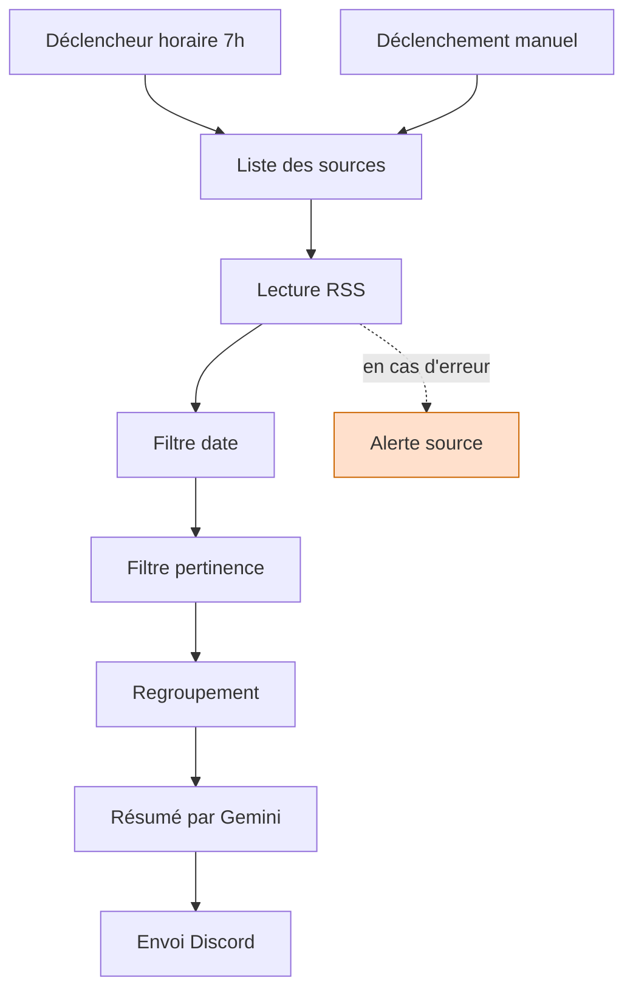

# Veille IA automatisée

Un workflow n8n qui lit des flux RSS chaque matin, filtre les articles pertinents, les fait résumer par un modèle de langage et envoie le digest sur Discord.

## Architecture

## Fonctionnement

Chaque matin à 7h, le workflow lit deux flux RSS d'actualité tech. Les articles passent par deux filtres successifs : d'abord la date, pour écarter ce qui a plus de sept jours, puis la pertinence, pour ne garder que ce qui relève de l'intelligence artificielle.

Les articles retenus sont regroupés en un seul bloc de texte, envoyé à un modèle de langage qui produit un paragraphe de tendance et sélectionne trois articles à lire. Le résultat part sur un salon Discord via un webhook.

Si une source ne répond pas, le workflow ne s'arrête pas : les autres sources continuent leur chemin, et un message d'alerte signale la source défaillante.

## Choix techniques

**Les sources sont des données, pas des nœuds.**
Plutôt qu'un nœud de lecture RSS par source, un nœud de code renvoie une liste d'URL que le nœud RSS consomme une par une. Ajouter une source revient à ajouter une ligne, sans toucher à la structure du workflow.

**Envoi via HTTP Request plutôt que le nœud Discord.**
n8n propose un nœud Discord prêt à l'emploi. Construire la requête à la main oblige à comprendre ce qui est réellement envoyé : méthode POST, corps au format JSON, webhook comme destination. Le nœud aurait masqué exactement ce que le projet cherchait à apprendre.

**Deux filtres séparés plutôt qu'une condition unique.**
Le filtre de date et le filtre de pertinence sont deux nœuds distincts. Chacun a une responsabilité unique, ce qui permet de voir combien d'articles chaque étape écarte, et de modifier l'un sans risquer de casser l'autre.

**Gemini en palier gratuit.**
Le modèle est appelé une fois par jour, bien en deçà des quotas gratuits. Les données traitées sont des titres d'articles publics, donc la contrepartie d'usage du palier gratuit est sans conséquence ici.

**Aucun secret dans le dépôt.**
La clé du modèle est stockée dans les credentials chiffrés de n8n. L'URL du webhook Discord est lue depuis une variable d'environnement. Le fichier JSON exporté ne contient que des références, jamais les valeurs.

## Limites connues

**Exécution locale.** n8n tourne sur une machine personnelle. Si elle est éteinte ou en veille à 7h, l'exécution n'a pas lieu et n'est pas reportée. Un hébergement permanent résoudrait le problème, pour un coût mensuel jugé disproportionné au regard de l'usage.

**Pas de déduplication.** Un article déjà envoyé peut réapparaître le lendemain tant qu'il reste dans la fenêtre de sept jours. La correction demande de mémoriser les liens déjà traités, ce qui suppose une base de données. Le besoin est identifié, la solution est reportée.

**Surveillance partielle des erreurs.** Une source RSS injoignable déclenche une alerte sur Discord. Une panne du modèle de langage ou de l'envoi Discord, en revanche, échoue en silence.

**Résumé à partir des titres.** Le workflow ne lit que les titres et les liens fournis par les flux RSS, pas le contenu des articles. Le résumé reflète donc ce que les titres annoncent, pas ce que les articles contiennent.

## Faire tourner le workflow

Le fichier `workflows/veille.json` ne contient aucun secret. Trois éléments sont donc à recréer localement.

1. **Installer n8n** et le lancer sur `localhost:5678`.
2. **Importer le workflow** depuis l'interface, menu *Import from file*.
3. **Créer une clé d'API Gemini** sur Google AI Studio, et l'enregistrer dans les credentials n8n du nœud correspondant.
4. **Créer un webhook Discord** dans les paramètres du salon de destination, puis exposer son URL dans une variable d'environnement nommée `DISCORD_WEBHOOK` avant de démarrer n8n.
5. **Autoriser la lecture des variables d'environnement** par les nœuds, n8n la bloquant par défaut, via `N8N_BLOCK_ENV_ACCESS_IN_NODE=false`.
6. **Publier le workflow** pour que le déclencheur horaire devienne actif. Tant qu'il reste en brouillon, seul le déclenchement manuel fonctionne.
