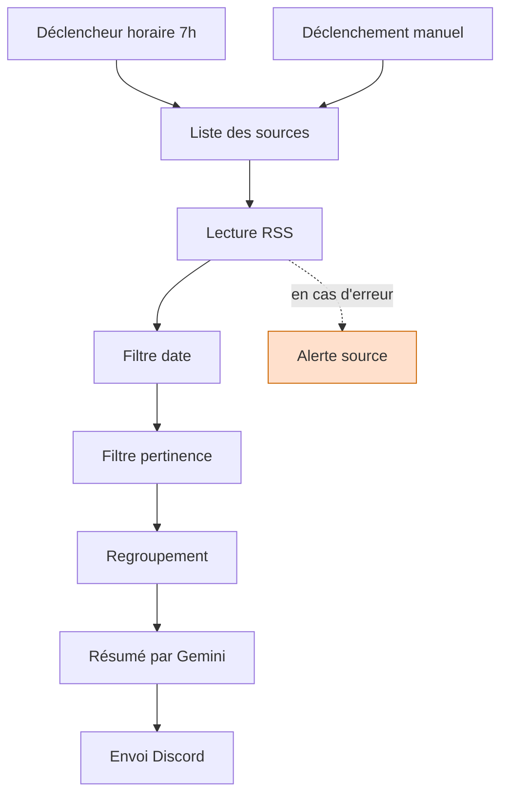

# Veille IA automatisée

Un workflow n8n qui lit des flux RSS chaque matin, filtre les articles pertinents, les fait résumer par un modèle de langage et envoie le digest sur Discord.

## Architecture

