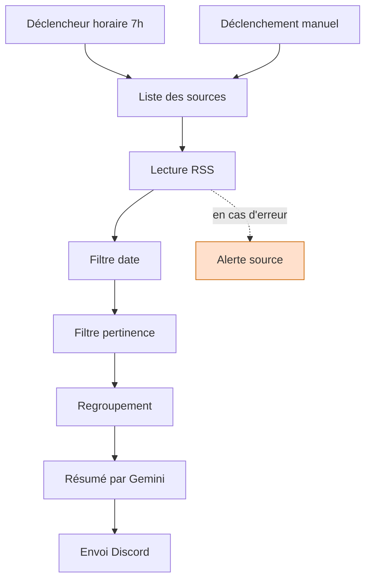

# Veille IA automatisée

Un workflow n8n qui lit des flux RSS chaque matin, filtre les articles pertinents, les fait résumer par un modèle de langage et envoie le digest sur Discord.

## Architecture

## Fonctionnement

Chaque matin à 7h, le workflow lit deux flux RSS d'actualité tech. Les articles passent par deux filtres successifs : d'abord la date, pour écarter ce qui a plus de sept jours, puis la pertinence, pour ne garder que ce qui relève de l'intelligence artificielle.

Les articles retenus sont regroupés en un seul bloc de texte, envoyé à un modèle de langage qui produit un paragraphe de tendance et sélectionne trois articles à lire. Le résultat part sur un salon Discord via un webhook.

Si une source ne répond pas, le workflow ne s'arrête pas : les autres sources continuent leur chemin, et un message d'alerte signale la source défaillante.
